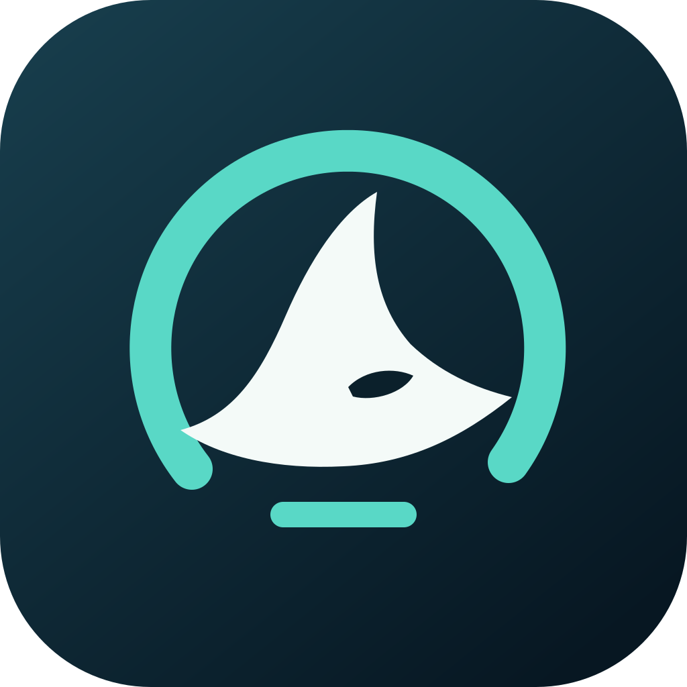
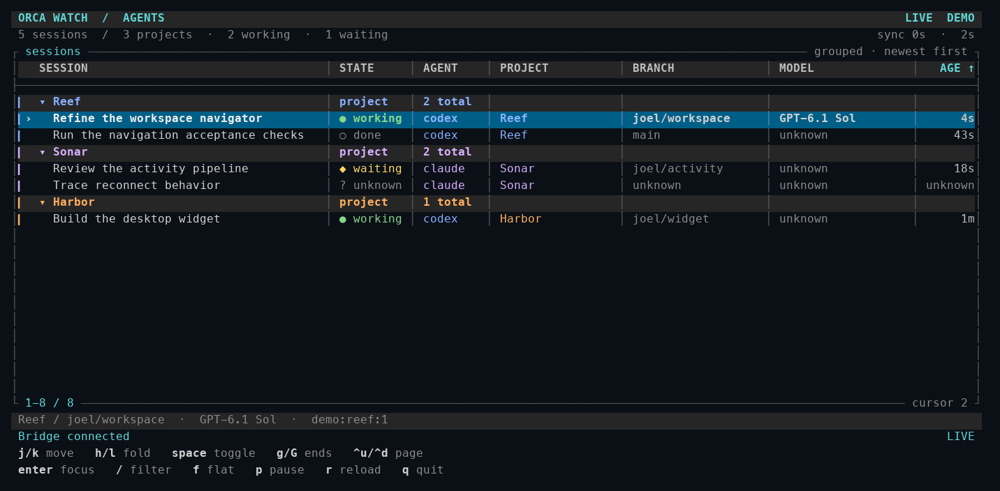

<p align="center"></p>

# Orca Watch

**Your agents, in motion.** A Swift terminal dashboard and macOS desktop widget for open [Orca](https://github.com/stablyai/orca) agents. Powered entirely by the [Orca Bridge CLI](https://github.com/joelthecoder/orca-bridge).

Recent activity rises to the top. Selection stays with the session as it moves. Projects have stable colors, nest their sessions, and collapse with a key. Switch to a flat view for a single global activity order.

The terminal uses a full-width table with aligned session, state, agent, project, branch, model and age columns. Session titles take the remaining width. Secondary columns disappear in narrower windows, with clipped cells marked by an ellipsis. A full-row cursor, project rails, status symbols and a bottom detail strip keep the view scannable. The design draws from [tig](https://github.com/jonas/tig) and the terminal references recorded in [the design notes](docs/terminal-design.md).



## Terminal

Requires macOS 14+, Swift 6+ and an installed `orca-bridge`. Orca must be running for live inventory. No pairing, additional credentials or Bridge recorder service is required.

```sh
make install
orca-watch
orca-watch --demo
orca-watch snapshot --json
orca-watch log --json
orca-watch log --once
```

| Key | Action |
| --- | --- |
| `j` / `k`, up / down | Move selection |
| `h` / `l`, left / right | Collapse / expand selected project |
| Space | Toggle selected project |
| `g` / `G` | First / last row |
| Ctrl-U / Ctrl-D | Half a page up / down |
| Page Up / Page Down | One page up / down |
| Home / End | First / last row |
| Ctrl-L | Redraw the screen |
| `f` | Toggle grouped / flat activity order |
| `/` | Filter project, title, agent and branch; Enter applies |
| Escape | Clear filter |
| Enter | Focus the selected live terminal through Bridge |
| `p` | Pause / resume refresh |
| `r` | Refresh |
| `q`, Ctrl-C | Quit and restore terminal settings |

`--interval SECONDS` sets snapshot polling, default two seconds, minimum 0.5. The screen updates only changed lines. Input remains responsive during collection. `--no-color` and `NO_COLOR` disable color. JSON never includes ANSI escapes. `snapshot` writes one compact JSON object; `log --json` writes JSONL `opened`, `activity` and `removed` observations. Removed means absent from the next successful live inventory, not proof that a conversation ended. Outages write diagnostics to stderr and do not manufacture removal events.

Use `--bridge /absolute/path/to/orca-bridge` or `ORCA_WATCH_BRIDGE` to select the executable. Otherwise discovery checks PATH, `~/.local/bin`, `/opt/homebrew/bin` and `/usr/local/bin`. Install location defaults to `~/.local/bin`; override with `make install INSTALL_DIR=/your/bin`.

## Desktop widget

An invisible widget helper collects snapshots and shares a compact cache with the WidgetKit extension. It has no window, Dock icon or menu bar item. The only interfaces are the CLI and desktop widget. WidgetKit requires a containing app bundle, which is used solely for background collection and session deep links.

Requires Xcode and [XcodeGen](https://github.com/yonaskolb/XcodeGen). A signed app and extension must use the same Apple development team to share their App Group container.

```sh
brew install xcodegen
make app                              # Unsigned compilation check
make install-widget TEAM_ID=YOUR_TEAM_ID  # Sign, install helper, start in background
orca-watch widget start
orca-watch widget status
orca-watch widget stop
```

The development team ID comes from your Xcode account. It is not the certificate's parenthesized personal identifier. The project uses a team-prefixed macOS App Group and preserves your signing configuration outside this repository.

After installation, right-click the desktop, choose **Edit Widgets**, and search for **Orca Watch**. Small and medium widgets show up to three sessions; large shows up to six. Clicking a session deep-links through the hidden helper, obtains a fresh live inventory, and focuses that session in Orca through Bridge. No dashboard opens.

`orca-watch widget start|stop|status` controls the background collector. Add `--json` for structured status. It does not automatically start at login. The helper discovers Bridge in the standard locations; override its path with `defaults write com.joelthecoder.orca-watch bridgePath /absolute/path/to/orca-bridge`, then restart it with the CLI.

The helper polls every two seconds and requests widget reloads at most every fifteen seconds. **macOS controls actual widget refresh timing.** Widgets display their last observation time and mark an observation older than thirty seconds with an amber indicator. They are a recent snapshot; use the terminal for continuous monitoring. See [Apple's refresh guidance](https://developer.apple.com/documentation/widgetkit/keeping-a-widget-up-to-date) and [macOS App Group requirements](https://developer.apple.com/documentation/xcode/accessing-app-group-containers).

## Data and identity

Every Orca read and navigation action invokes `orca-bridge`. This project does not read Orca databases, credentials, sockets or transcripts directly. It uses snapshot schema 1, rejects unknown schemas, and retains the last known list with a stale diagnostic during runtime failures.

Indexed sessions require Bridge's live binding plus a matching current runtime and terminal incarnation. Other connected agent terminals appear with their tab title, explicit unknown fields, and an incarnation-qualified identity until indexing catches up. Selection follows that transition when terminal and incarnation still match. Titles and folder names never establish conversation ownership.

Activity is the newest provider/index update or agent-status timestamp supplied by Bridge. It is not a keystroke or terminal-output activity meter. Unknown timestamps sort last, with stable ID tie breaks. Grouped mode orders projects by their newest session and sessions within each project by activity. Colors derive from project identity and do not change with list position. Bridge history is bounded at 2000 sessions; a truncation warning stays visible, and unindexed live terminals remain included.

The shared cache contains display metadata, live terminal handles and session IDs, not transcripts. It resides in the signed app's private App Group container with owner-only file permissions. Runtime data, build directories, generated Xcode projects and local signing state are ignored by Git.

## Develop

```sh
make check       # Behavioral tests, formatting, warnings-as-errors build, PTY acceptance
make format
make app         # Compile containing app and WidgetKit extension
make previews    # Render synthetic widget cards for visual inspection
make icons       # Rebuild ICNS and Orca PNGs from SVG (requires librsvg)
```

`Sources/OrcaWatchCore` owns decoding, projection, sorting, selection, subprocess handling and cache encoding. `Sources/OrcaWatchTerminal` owns cell-aware table layout and rendering. `Sources/OrcaWatchCLI` owns terminal interaction. `App`, `Widget` and `Shared` provide the native surfaces. Tests use synthetic data; live smoke results never become fixtures.

Artwork lives in [Assets](Assets/BrandGuidelines.md). The checked-in PNGs and ICNS are intentional shipping exports. Apply the project icon through Bridge:

```sh
orca-bridge projects icon apply path:/absolute/orca-watch --file /absolute/orca-watch/Assets/Orca/ProjectIcon/icon.png
```

This is an independent project. Orca's name and marks belong to their owners.
